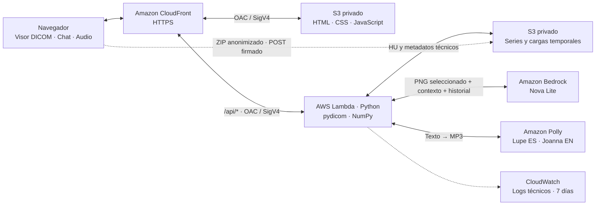

# DICOM Lab · SIPAIM 2026

Lector de imágenes médicas con Python, chat educativo bilingüe con **Amazon Bedrock** y explicaciones en audio con **Amazon Polly**. Incluye el notebook de la charla **«Explorando imágenes médicas con DICOM: introducción práctica con Python»**.

**[Abrir la aplicación](https://dzij5ey0xgf92.cloudfront.net)** · [Notebook de Google Colab](SIPAIM_2026_DICOM_Python.ipynb)

> Material educativo y de investigación. No sirve para diagnóstico clínico. Utilice únicamente imágenes públicas o anonimizadas.

## Qué permite hacer

- Explorar tres series CT públicas: **LIDC-IDRI-1001**, **cráneo/cerebro GE** y **fantoma Philips**.
- Recorrer cortes y cambiar ventanas; obtener MPR con proporciones físicas correctas cuando la geometría lo permite.
- Medir HU directamente sobre el volumen original y guardar el corte visible.
- Conversar en **español o inglés**, hacer preguntas de seguimiento y practicar con un tutor que espera la respuesta del usuario.
- Enviar más preguntas mientras se genera una explicación: la cola evita perder mensajes. Se puede detener o reintentar y empezar una conversación nueva.
- Escuchar y descargar un MP3 en un idioma independiente del texto. Si hace falta, Bedrock traduce antes de que Polly lo lea.
- Importar un ZIP de CT axial regular anonimizada, con almacenamiento privado y caducidad temporal.

La aplicación abre directamente, **sin código de entrada**. La infraestructura conserva S3 privado y autenticación OAC/SigV4 entre CloudFront y los orígenes. Las credenciales AWS nunca llegan al navegador.

## Arquitectura


**Para las diapositivas:** [PNG 4K, 3840 × 2160](docs/arquitectura/arquitectura-dicom-lab.png) · [SVG editable](docs/arquitectura/arquitectura-dicom-lab.svg).



El procesamiento numérico ocurre en Python: lectura, geometría, ventanas y medición de HU. Bedrock recibe **el corte visible convertido a PNG y datos técnicos**, no el DICOM bruto ni los identificadores del paciente. Polly devuelve el audio. El historial de conversación vive en el navegador y se incluye en cada consulta; no existe una base de datos de conversaciones. [Detalles y flujo de importación](docs/arquitectura.md).

## Contenido del proyecto

```text
.
├── SIPAIM_2026_DICOM_Python.ipynb  # Taller completo para Colab
├── crear_notebook.py              # Generador del notebook
├── validar_notebook.py            # Validación estática del material
├── ejecutar_verificacion.py       # Ejecución científica local adaptada
├── generar_arquitectura.py        # PNG 4K y SVG del diagrama
├── scripts/descargar_datos.py     # Solo las series públicas necesarias
├── app/
│   ├── frontend/                 # Visor y chat, sin framework ni build
│   ├── backend/                  # API Lambda y procesamiento DICOM
│   ├── prepare_data.py           # Volúmenes HU y metadatos técnicos
│   ├── aws_config.py             # Perfil local y TLS
│   ├── deploy.py                 # CloudFormation y publicación
│   ├── api.openapi.json          # Contrato HTTP
│   ├── local_server.py           # Vista previa con llamadas AWS reales
│   ├── tests/                    # Pruebas Python y del chat en DOM
│   └── postman/                  # Simulación local de fallos AWS
├── docs/                         # Arquitectura, instrucciones y evidencia
├── ejemplos/figuras_ppt/          # Cinco PNG derivados de los datos públicos
└── licenses/                     # Licencia del repositorio de cráneo
```

No se versionan credenciales, claves anteriores, archivos `.env`, entornos virtuales, paquetes instalados, DICOM, volúmenes NumPy/NIfTI ni resultados de cargas de usuarios. Los datos se descargan de sus fuentes originales.

## 1. Usar solamente el notebook

1. Descargue `SIPAIM_2026_DICOM_Python.ipynb`.
2. En Google Colab, seleccione **Archivo → Subir notebook**.
3. Use **CPU**, sin GPU, y ejecute las celdas en orden.
4. La sección de preparación instala bibliotecas y descarga las tres series públicas. El respaldo opcional se configura desde Google Drive.
5. La última sección genera `figuras_ppt.zip` y lo descarga.

El archivo GE **`18.dcm`** es siempre la referencia para los ejemplos 2D. La serie GE tiene inclinación y separación irregular: se conserva para exploración axial y se excluye de las MPR simples. El fantoma Philips y el tórax LIDC-IDRI se utilizan para volumen y MPR. El fantoma es un maniquí, no un cerebro humano.

## 2. Preparar el proyecto local

Requisitos: **Python 3.12**, Git, **Node.js 24** para las pruebas del chat y **AWS CLI v2** para AWS. No hace falta Docker ni una GPU.

```powershell
git clone https://github.com/lvaldivia/sipaim-2026-dicom-lab.git
cd sipaim-2026-dicom-lab
python -m venv .venv
.\.venv\Scripts\Activate.ps1
python -m pip install -r requirements.txt
python scripts/descargar_datos.py
python app/prepare_data.py
```

En macOS/Linux, active el entorno con `source .venv/bin/activate`; el resto de comandos `python ...` es equivalente.

El verificador debe encontrar **28 cortes GE**, **140 Philips** y **194 LIDC-IDRI**. Las series se guardan en `dcm_qa_ct/` y `torax_lidc/`, excluidas de Git. `prepare_data.py` genera volúmenes en HU y metadatos técnicos en `app/data/`.

## 3. Configurar AWS y probar los servicios

La implementación actual usa **us-east-1** y, de forma predeterminada, el perfil **luisvaldivia**:

```powershell
aws configure --profile luisvaldivia
aws sts get-caller-identity --profile luisvaldivia
python app/check_aws.py
```

Puede usar un perfil existente en lugar de volver a configurarlo. Para cambiarlo en PowerShell: `$env:AWS_PROFILE = 'otro-perfil'`; en Bash: `export AWS_PROFILE=otro-perfil`.

Necesita permiso para invocar **amazon.nova-lite-v1:0**, sintetizar voz con Polly y desplegar los recursos del proyecto: CloudFormation, IAM, S3, Lambda, CloudFront y CloudWatch. El rol de ejecución creado para Lambda tiene permisos más acotados que el perfil de despliegue. `check_aws.py` realiza una llamada pequeña a Bedrock y dos a Polly, con consumo real de AWS.

Si la organización utiliza certificados corporativos, configure `AWS_CA_BUNDLE` con el archivo PEM apropiado. En Windows, `aws_config.py` puede exportar los certificados públicos de confianza del sistema a `.local/`, sin desactivar la validación TLS ni copiar claves privadas.

## 4. Ejecutar la aplicación localmente

```powershell
python app/local_server.py
```

Abra **http://127.0.0.1:8765**. Usa las series preparadas en `app/data/`; el chat y el audio hacen llamadas reales con el perfil local. La importación de ZIP requiere el bucket del despliegue (o `DATA_BUCKET`). [Documentación de la aplicación](app/README.md).

## 5. Desplegar o actualizar en AWS

Prepare los datos y después cree el paquete Linux para Lambda, aunque desarrolle desde Windows:

```powershell
python -m pip install --target app/.build/package --platform manylinux_2_28_x86_64 --platform manylinux2014_x86_64 --python-version 3.12 --implementation cp --only-binary :all: --no-compile numpy pydicom Pillow
python app/deploy.py
```

El script publica el frontend y las series, crea o actualiza el stack **`sipaim-dicom-lab`** e invalida la caché de CloudFront. Genera `app/cloudformation.json` y las salidas en `app/deployment.json`; ambos son archivos locales, no versionados. **Ejecutarlo con el perfil del despliegue actual actualizará la aplicación existente.** No hace falta reconstruir el notebook para cambiar solamente la aplicación.

La función Lambda utiliza Python 3.12, 2048 MB, máximo 90 segundos y concurrencia reservada de 3. No hay capacidad provisionada ni GPU. AWS factura almacenamiento y consumo de Bedrock, Polly, Lambda, CloudFront y registros. Para retirar el despliegue, elimine su stack y después el bucket específico del proyecto; [lea los límites operativos](docs/arquitectura.md) antes de hacerlo.

## 6. Validar

```powershell
python validar_notebook.py
python -m pytest app/tests -q
node --check app/frontend/app.js
npm install --prefix app/.test-tools jsdom --no-fund --no-audit
node --test app/tests/chat-ui.test.cjs
```

Las pruebas unitarias no invocan Bedrock/Polly. La prueba de GE se omite si no descargó sus datos. Para probar **los servicios desplegados reales**, con consumo de AWS e importación de seis cortes del fantoma:

```powershell
python app/smoke_test.py https://dzij5ey0xgf92.cloudfront.net
```

Resultado verificado durante la construcción: **10 pruebas Python**, **1 prueba de interfaz en DOM** y **21 comprobaciones HTTP reales**, incluyendo conversación de varios turnos, audio bilingüe e importación. La revisión visual en un navegador real sigue pendiente por restricciones de control del entorno. La simulación Postman no pudo iniciarse por un problema TLS de su daemon local; no se presenta como una prueba pasada. [Evidencia y alcance](docs/verificacion.md).

Se incluye una [plantilla de GitHub Actions](docs/ci/checks.yml) para ejecutar las comprobaciones locales en push y pull request, sin credenciales AWS ni consumo de Bedrock/Polly. Quedó como plantilla porque la sesión OAuth de GitHub utilizada para el push no tiene el alcance `workflow`. Para activarla, copie el archivo a `.github/workflows/checks.yml` desde una sesión autorizada para gestionar workflows. Las pruebas locales indicadas arriba sí se ejecutaron.

## 7. Regenerar la imagen para PowerPoint

```powershell
python generar_arquitectura.py
```

Guarda un **PNG 4K 16:9** y un **SVG con texto editable** en `docs/arquitectura/`. En PowerPoint: **Insertar → Imágenes → Este dispositivo** y seleccione el PNG. Puede insertar el SVG si desea escalarlo sin perder calidad.

## Datos, créditos y licencias

- **[LIDC-IDRI / TCIA](https://doi.org/10.7937/K9/TCIA.2015.LO9QL9SX)**: Armato III y colaboradores. **CC BY 3.0**. Serie LIDC-IDRI-1001, descargada a través de NCI Imaging Data Commons. Las imágenes de ejemplo son derivados con ventaneo, segmentación o submuestreo, sin utilizar las anotaciones expertas de nódulos.
- **[dcm_qa_ct](https://github.com/neurolabusc/dcm_qa_ct)**: Chris Rorden. **BSD-2-Clause**, conservada en [licenses/](licenses/dcm_qa_ct-BSD-2-Clause.txt). CT GE cortesía de Aliza Medical Imaging; fantoma Philips cortesía de Paul Morgan, Nottingham Medical School. Las miniaturas y PNG derivados conservan esta atribución.
- **Marching cubes:** Lorensen y Cline, SIGGRAPH 1987, [DOI 10.1145/37401.37422](https://doi.org/10.1145/37401.37422).

Los datos conservan sus licencias originales. La importación de un archivo no garantiza que esté anonimizado: deben revisarse también los textos incrustados en píxeles y el contexto de uso. Las explicaciones generativas pueden contener errores y se limitan al corte seleccionado.
