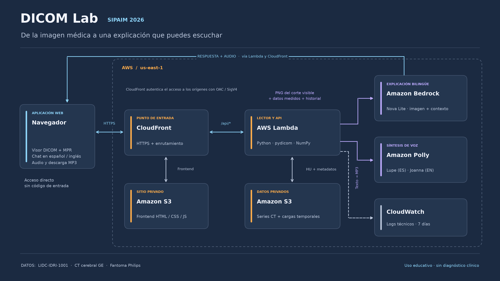
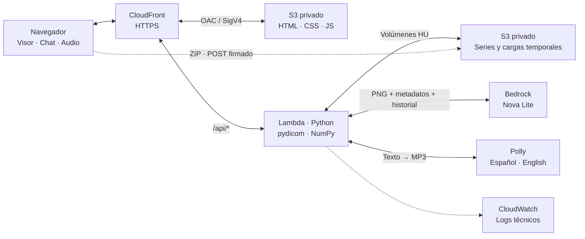

# DICOM Lab · SIPAIM 2026

Laboratorio educativo para explorar imágenes médicas DICOM con Python, conversar sobre ellas en español o inglés con **Amazon Bedrock** y escuchar las explicaciones con **Amazon Polly**.

Este repositorio está pensado para que los asistentes puedan continuar la práctica en sus equipos y, opcionalmente, desplegar una copia en **su propia cuenta de AWS**. No necesitan credenciales del autor. Todos los ejemplos de AWS utilizan un perfil nuevo llamado **`sipaim-lab`**.

> El material es educativo y de investigación. No sirve para diagnóstico clínico. Utiliza imágenes públicas o correctamente anonimizadas.

**[Demo de referencia](https://dzij5ey0xgf92.cloudfront.net)** · [Notebook para Colab](SIPAIM_2026_DICOM_Python.ipynb) · [Arquitectura PNG 4K](docs/arquitectura/arquitectura-dicom-lab.png) · [Arquitectura SVG editable](docs/arquitectura/arquitectura-dicom-lab.svg)

## Índice

1. [Qué puedes hacer y qué ruta elegir](#1-qué-puedes-hacer-y-qué-ruta-elegir)
2. [Arquitectura y datos utilizados](#2-arquitectura-y-datos-utilizados)
3. [Requisitos y descarga del repositorio](#3-requisitos-y-descarga-del-repositorio)
4. [Ruta A: ejecutar únicamente el notebook en Colab](#4-ruta-a-ejecutar-únicamente-el-notebook-en-colab)
5. [Preparar Python y descargar los datos en tu equipo](#5-preparar-python-y-descargar-los-datos-en-tu-equipo)
6. [Crear tu perfil AWS sipaim-lab](#6-crear-tu-perfil-aws-sipaim-lab)
7. [Seleccionar el perfil y comprobar los servicios](#7-seleccionar-el-perfil-y-comprobar-los-servicios)
8. [Ruta B: ejecutar la aplicación localmente](#8-ruta-b-ejecutar-la-aplicación-localmente)
9. [Ruta C: desplegar tu propia copia en AWS](#9-ruta-c-desplegar-tu-propia-copia-en-aws)
10. [Cómo usar el visor, el chat y el audio](#10-cómo-usar-el-visor-el-chat-y-el-audio)
11. [Pruebas y comprobaciones](#11-pruebas-y-comprobaciones)
12. [Errores frecuentes y cómo resolverlos](#12-errores-frecuentes-y-cómo-resolverlos)
13. [Actualizar o retirar tu despliegue](#13-actualizar-o-retirar-tu-despliegue)
14. [Archivos del proyecto e imágenes para PowerPoint](#14-archivos-del-proyecto-e-imágenes-para-powerpoint)
15. [Créditos, licencias y alcance](#15-créditos-licencias-y-alcance)

## 1. Qué puedes hacer y qué ruta elegir

La aplicación permite recorrer cortes CT, ajustar ventanas, ver reconstrucciones multiplanares, medir HU y consultar un tutor conversacional. El texto y el audio pueden estar en idiomas diferentes. También puede importar un ZIP de CT axial regular anonimizada.

No tienes que desplegar toda la arquitectura para aprender DICOM. Elige una ruta:

| Ruta | Qué ejecutas | ¿Necesitas AWS propio? | Qué se consume |
|---|---|---|---|
| A · Notebook | El taller científico en Google Colab | No | Entorno de Colab y descargas de datos públicos |
| B · Aplicación local | Visor en tu equipo; Bedrock y Polly en tu cuenta | Sí, con permisos de inferencia y voz | Invocaciones AWS; CPU y memoria de tu equipo |
| C · Aplicación desplegada | Tu frontend, API y datos en AWS | Sí, además con permisos de despliegue | S3, CloudFront, Lambda, registros, Bedrock y Polly |

La **demo de referencia** enlazada arriba pertenece al entorno de demostración del taller. Su URL no es la dirección de tu futura aplicación. Al desplegar tu copia obtendrás otra URL en `app/deployment.json`; utiliza esa dirección para tus pruebas reales.

## 2. Arquitectura y datos utilizados





Python lee DICOM, aplica la calibración, calcula HU y prepara el corte visible. Bedrock recibe ese corte como PNG, sus datos técnicos y el historial de la conversación. Polly convierte la explicación a audio; si el idioma del audio difiere del texto, Bedrock traduce primero. Las mediciones numéricas no se deducen de la respuesta del modelo. [Descripción detallada de los flujos y límites](docs/arquitectura.md).

| Serie | Uso | Cortes válidos | Consideración importante |
|---|---|---:|---|
| GE HiSpeed Dual, cráneo humano | Lectura DICOM, HU y cerebro en ventana 40/80 | 28 | `18.dcm` es la referencia; geometría inclinada e irregular, sin MPR simple |
| Philips Ingenuity, fantoma de cráneo | Volumen, MPR y superficie ósea | 140 | Es un maniquí; no contiene un cerebro humano |
| LIDC-IDRI-1001, CT torácica | Pulmón, mediastino, MPR y segmentación didáctica | 194 | Separación entre centros 1,8 mm; grosor declarado 2 mm |

Los DICOM y los volúmenes no están incluidos en Git. Se descargan de sus repositorios originales mediante el script de preparación.

## 3. Requisitos y descarga del repositorio

Para la ruta A basta un navegador con acceso a Google Colab. Para trabajar localmente:

| Herramienta | Uso | Comprobación |
|---|---|---|
| Python **3.12** | Procesamiento, backend y scripts de despliegue | `python --version` o `py -3.12 --version` |
| Git | Clonar este proyecto y descargar el cráneo por sparse checkout | `git --version` |
| AWS CLI **v2** | Configurar tu perfil y consultar tu cuenta | `aws --version` |
| Node.js **24**, opcional | Pruebas automatizadas de la interfaz | `node --version` y `npm --version` |

No necesitas GPU, Docker, React ni un proceso de compilación para el frontend. Node.js no es necesario para abrir el notebook ni para ejecutar el servidor Python. Reserva varios GB de disco para el entorno, bibliotecas, datos y volúmenes derivados.

Instala AWS CLI desde las [instrucciones oficiales para tu sistema](https://docs.aws.amazon.com/cli/latest/userguide/getting-started-install.html). Reabre la terminal después de instalar Python, Git o AWS CLI si todavía no aparecen en PATH.

Clona el repositorio y entra en la carpeta:

```text
git clone https://github.com/lvaldivia/sipaim-2026-dicom-lab.git
cd sipaim-2026-dicom-lab
```

También puedes descargar un ZIP desde **Code → Download ZIP**, extraerlo y abrir una terminal en la carpeta que contiene `README.md`. Git seguirá siendo necesario si ejecutas el script de descarga de datos.

Si GitHub muestra `Repository not found`, verifica que hayas iniciado sesión y tengas acceso al repositorio, que puede distribuirse como privado. El perfil AWS no otorga acceso a GitHub; son credenciales y servicios distintos. Solicita acceso o una copia del proyecto al organizador.

**Ejecuta los siguientes comandos desde la raíz del proyecto**, no desde `app/`. Esto mantiene coherentes las rutas de datos, resultados y entorno virtual.

## 4. Ruta A: ejecutar únicamente el notebook en Colab

1. Descarga `SIPAIM_2026_DICOM_Python.ipynb`.
2. En [Google Colab](https://colab.research.google.com/), selecciona **Archivo → Subir notebook**.
3. Usa un entorno con CPU; no selecciones GPU.
4. Ejecuta las celdas en orden. La sección **0 · Preparación** instala las bibliotecas y descarga las series.
5. Comprueba los recuentos esperados de la tabla anterior antes de continuar.
6. Sigue las Partes 1 a 4 y los ejercicios. Las soluciones están en celdas separadas.
7. En la última sección, ejecuta la exportación de figuras. Colab descargará `figuras_ppt.zip`.

No necesitas configurar `sipaim-lab` ni ejecutar `app/deploy.py` para esta ruta. El notebook científico no invoca Bedrock ni Polly.

El respaldo de Drive se configura con `USAR_DRIVE=True` dentro del notebook y las carpetas descargadas previamente. Drive e instalación de bibliotecas también requieren conectividad; una copia local sigue siendo útil ante una interrupción completa de Internet.

## 5. Preparar Python y descargar los datos en tu equipo

Este paso es para las rutas B y C.

### Windows · PowerShell

```powershell
py -3.12 -m venv .venv
.\.venv\Scripts\Activate.ps1
python --version
python -m pip install --upgrade pip
python -m pip install -r requirements.txt
```

Si PowerShell no permite activar el entorno, puedes usar directamente su intérprete, sin cambiar políticas del equipo:

```powershell
.\.venv\Scripts\python.exe -m pip install -r requirements.txt
.\.venv\Scripts\python.exe scripts/descargar_datos.py
```

En ese caso, sustituye `python` por `.\.venv\Scripts\python.exe` en los comandos posteriores.

### macOS / Linux · Bash o Zsh

```bash
python3.12 -m venv .venv
source .venv/bin/activate
python --version
python -m pip install --upgrade pip
python -m pip install -r requirements.txt
```

### Descargar y preparar las tres series

Con el entorno activo, en cualquier sistema:

```text
python scripts/descargar_datos.py
python app/prepare_data.py
```

El primer script descarga solo las dos subcarpetas de cráneo necesarias y una serie LIDC-IDRI por UID fijo. No descarga colecciones completas de IDC. Debe imprimir 28 cortes GE, 140 Philips y 194 de tórax.

El segundo script calibra cada corte con su pendiente e intercepto, revisa la geometría y genera:

```text
app/data/manifest.json
app/data/head/metadata.json
app/data/head/volume.npz
app/data/thorax/metadata.json
app/data/thorax/volume.npz
app/data/phantom/metadata.json
app/data/phantom/volume.npz
```

También prepara las miniaturas del frontend. Estas descargas no requieren una cuenta AWS: son datos públicos. Los archivos grandes se mantienen locales y están excluidos de Git.

## 6. Crear tu perfil AWS sipaim-lab

Un **perfil** es un nombre local que permite a AWS CLI y boto3 seleccionar credenciales y configuración. No crea una cuenta AWS, un usuario IAM ni permisos por sí solo. `sipaim-lab` es un alias de ejemplo: cada participante debe asociarlo a **sus propias credenciales y cuenta autorizada**. [Referencia oficial de perfiles](https://docs.aws.amazon.com/cli/latest/userguide/cli-configure-files.html).

Para usar Bedrock/Polly necesitas una cuenta o sandbox con acceso a esos servicios. Para desplegar, tu rol debe permitir además crear infraestructura. En un entorno universitario o empresarial, pide al administrador o al organizador el mecanismo de acceso previsto.

### Opción recomendada cuando tu organización usa IAM Identity Center / SSO

```text
aws configure sso --profile sipaim-lab
```

El asistente solicita la sesión y el acceso de tu organización. La **SSO start URL** y la **SSO region** te las proporciona el administrador; no deben inventarse y la región SSO puede diferir de la región de la aplicación. Selecciona la cuenta y el rol que te hayan asignado. Cuando pida la región predeterminada de los clientes, utiliza **`us-east-1`**; para el formato de salida puedes elegir **`json`**.

Después inicia sesión y verifica la identidad:

```text
aws sso login --profile sipaim-lab
aws sts get-caller-identity --profile sipaim-lab
```

La autenticación se completa en el navegador. Si la sesión caduca, repite `aws sso login --profile sipaim-lab`. [Guía oficial de configuración SSO](https://docs.aws.amazon.com/cli/latest/userguide/cli-configure-sso.html).

### Alternativa si te proporcionaron credenciales de laboratorio

Si el laboratorio utiliza claves autorizadas en lugar de SSO:

```text
aws configure --profile sipaim-lab
```

Introduce **tus** valores cuando el asistente los solicite:

| Campo del asistente | Qué introducir |
|---|---|
| AWS Access Key ID | La clave del usuario o sesión que te hayan asignado |
| AWS Secret Access Key | Su secreto correspondiente |
| Default region name | `us-east-1` |
| Default output format | `json` |

Si recibiste credenciales **temporales**, necesitas también `aws_session_token`. En sandboxes como los proporcionados por un laboratorio, copia el bloque de credenciales desde el portal del laboratorio al archivo **local** de credenciales, dentro del perfil `[sipaim-lab]`. Sin el token, una clave temporal no funcionará. Renueva todo el bloque al caducar la sesión.

No publiques esas claves, no las añadas a este README y no las guardes en archivos del repositorio. No uses credenciales del usuario root de una cuenta. Los archivos de configuración pertenecen al directorio de tu usuario (`~/.aws/`), no al código del proyecto.

### Comprobar la cuenta que vas a utilizar

```text
aws sts get-caller-identity --profile sipaim-lab
```

La salida contiene `Account` y `Arn`. Comprueba que sean la cuenta y el rol asignados para **tu práctica**. Por ejemplo, el formato es similar al siguiente; los valores son ilustrativos:

```json
{
  "Account": "111122223333",
  "Arn": "arn:aws:sts::111122223333:assumed-role/RolDelLaboratorio/tu-sesion"
}
```

Obtener esta respuesta confirma la identidad, pero no demuestra que el rol permita todos los servicios del despliegue.

## 7. Seleccionar el perfil y comprobar los servicios

Los scripts Python usan **`AWS_PROFILE`** y, si no lo defines, buscan el perfil **`sipaim-lab`**. La región de esta implementación es **`us-east-1`**. Para cambiar de región habría que revisar modelos, voces y despliegue; no basta con cambiar una línea en AWS CLI.

Configura también un nombre de stack que identifique tu práctica. **Sustituye `ana` por tu alias**, especialmente si varias personas comparten una cuenta:

### PowerShell

```powershell
$env:AWS_PROFILE = "sipaim-lab"
$env:AWS_STACK_NAME = "sipaim-lab-ana"
aws sts get-caller-identity --profile sipaim-lab
python app/check_aws.py
```

### Bash / Zsh

```bash
export AWS_PROFILE=sipaim-lab
export AWS_STACK_NAME=sipaim-lab-ana
aws sts get-caller-identity --profile sipaim-lab
python app/check_aws.py
```

Estas variables se aplican a la terminal actual. Si abres otra terminal, activa de nuevo `.venv` y vuelve a definirlas. `AWS_STACK_NAME` debe tener entre 3 y 30 caracteres: minúsculas, números y guiones; comenzar con letra y terminar con letra o número. Si no se define, el nombre por defecto es `sipaim-dicom-lab`.

`check_aws.py` invoca de verdad Nova Lite y genera dos muestras cortas de voz. Debes ver una confirmación de Bedrock y un tamaño en bytes para cada MP3. No es una prueba simulada: consume servicios AWS.

| Para qué | Acceso necesario |
|---|---|
| Chat | `bedrock:InvokeModel` para `amazon.nova-lite-v1:0` en `us-east-1` |
| Audio | `polly:SynthesizeSpeech`; voces neurales Lupe/es-US y Joanna/en-US |
| Desplegar | CloudFormation, S3, Lambda, CloudFront, CloudWatch Logs e IAM, incluido crear/asignar el rol de Lambda |

No todos los sandboxes permiten crear roles IAM o distribuciones CloudFront. Si tu entorno solo permite inferencia, puedes utilizar la ruta B sin desplegar toda la arquitectura. La importación local de ZIP requiere además el bucket correspondiente.

Comprueba que el modelo esté disponible y autorizado en tu cuenta. La disponibilidad de un modelo en el catálogo no sustituye los permisos IAM ni las condiciones específicas de acceso de esa cuenta. [Referencia de acceso a modelos Bedrock](https://docs.aws.amazon.com/bedrock/latest/userguide/model-access.html).

## 8. Ruta B: ejecutar la aplicación localmente

Después de preparar los datos y seleccionar tu perfil:

```text
python app/local_server.py
```

Abre **http://127.0.0.1:8765** en el navegador. Verás la biblioteca de tres estudios. El visor utiliza los volúmenes de `app/data/`; las preguntas y el audio usan Bedrock/Polly en **tu cuenta**.

- Mantén la terminal abierta mientras usas la aplicación.
- Para detener el servidor, pulsa **Ctrl+C** en esa terminal.
- El puerto solo escucha en tu equipo (`127.0.0.1`).
- Puedes explorar y conversar sin desplegar CloudFront/Lambda.
- **Importar DICOM** necesita un bucket y sus permisos; para esa función completa la ruta C o configura `DATA_BUCKET` con un bucket de tu entorno preparado para la aplicación.

El servidor local busca el bucket de `app/deployment.json` si ya desplegaste. Si no existe, calcula su nombre a partir de tu stack, cuenta y región. Calcular el nombre no crea el bucket.

## 9. Ruta C: desplegar tu propia copia en AWS

Antes de comenzar debes tener los datos en `app/data/`, las variables de tu terminal definidas y el perfil verificado.

### 9.1 Preparar las dependencias de Lambda

Lambda ejecutará **Python 3.12 sobre Linux x86_64**. Por eso no debes enviar las bibliotecas binarias de tu entorno Windows/macOS. Descarga los paquetes de destino con este comando, válido desde los sistemas del laboratorio:

```text
python -m pip install --target app/.build/package --platform manylinux_2_28_x86_64 --platform manylinux2014_x86_64 --python-version 3.12 --implementation cp --only-binary :all: --no-compile numpy pydicom Pillow
```

Debes obtener `numpy`, `pydicom` y `PIL` dentro de `app/.build/package/`. El entorno `.venv` sigue conteniendo las bibliotecas de tu equipo; `.build/package` contiene las que se enviarán a Lambda. No los intercambies.

### 9.2 Desplegar

```text
python app/deploy.py
```

El script comprueba los archivos necesarios antes de crear recursos. Después:

1. Obtiene la cuenta mediante STS y muestra perfil, cuenta, región y stack.
2. Crea o utiliza el bucket de **tu stack y tu cuenta**, con acceso público bloqueado y cifrado.
3. Empaqueta el backend y las dependencias Linux.
4. Publica el frontend y los volúmenes públicos preparados.
5. Crea o actualiza CloudFormation: rol IAM, logs, Lambda, URL protegida, CloudFront y políticas de acceso.
6. Configura la carga S3 desde la URL de tu aplicación e invalida la caché.
7. Guarda tus salidas en `app/deployment.json`.

Los recursos incluyen el nombre del stack: por ejemplo, `sipaim-lab-ana-api` para Lambda y un bucket con el stack, ID de **tu cuenta** y región. Esto permite separar participantes que comparten una cuenta. No uses el mismo stack que otra persona en esa cuenta.

No cierres la terminal mientras el script esté creando o actualizando el stack. CloudFront puede necesitar varios minutos para propagar su configuración. El resultado correcto termina en `CREATE_COMPLETE` o `UPDATE_COMPLETE` y muestra **tu nueva URL**.

### 9.3 Consultar tus salidas

PowerShell:

```powershell
Get-Content app/deployment.json
$miDespliegue = Get-Content app/deployment.json | ConvertFrom-Json
$miDespliegue.Url
```

Bash/Zsh:

```bash
cat app/deployment.json
python -c 'import json; print(json.load(open("app/deployment.json"))["Url"])'
```

El archivo incluye `Url`, `DistributionId`, `FunctionName`, `Bucket`, `FunctionUrl`, `StackName` y `Region`. Abre **`Url`**, no `FunctionUrl`: el origen de Lambda está protegido y la navegación normal pasa por CloudFront.

`app/cloudformation.json` es el template generado para tu despliegue. Ambos JSON son locales y no se suben a Git. Cada clon debe generar sus propias salidas.

## 10. Cómo usar el visor, el chat y el audio

1. **Selecciona un estudio** en la columna izquierda.
2. **Recorre cortes** con el slider. El contador visible empieza en 1; la API utiliza índices desde 0.
3. **Cambia de ventana** con los botones o los controles de nivel/ancho. Estos ajustes cambian la presentación, no los HU originales.
4. **Prueba coronal o sagital** en tórax o fantoma. En GE están desactivados por la geometría irregular.
5. **Haz clic en la imagen** para medir HU. La medición se puede incluir como contexto en la siguiente pregunta.
6. **Escribe una pregunta** y pulsa Enter o el botón de envío. Shift+Enter añade una línea.
7. **Continúa la conversación** con «¿por qué?», «explícalo con un ejemplo» o los botones «Más sencillo» y «Profundizar».
8. **Pulsa «Pregúntame»** para practicar. El tutor hará una pregunta; responde en el mismo chat y comentará tu respuesta.
9. **Cambia de idioma** mediante el selector o pídelo expresamente: «respóndeme en inglés» / «answer in Spanish».
10. **Elige el idioma del audio** y pulsa «Generar audio». Puedes escuchar la respuesta o descargar su MP3.

Mientras llega una explicación puedes dejar hasta tres preguntas en cola. Se procesan en orden y se identifican como pendientes. «Detener» cancela la espera y las preguntas pendientes en el navegador; una inferencia que ya empezó en AWS puede seguir consumiendo recursos. «Nueva conversación» borra el historial local del chat. Cambiar de estudio inicia otro contexto.

Ejemplos adecuados para practicar:

- «¿Qué representa PixelSpacing y en qué se diferencia de SliceThickness?»
- «¿Por qué una ventana estrecha aumenta el contraste?»
- «Explícame la diferencia entre el cerebro y el cráneo en estas ventanas».
- «Hazme una pregunta sobre HU y espera mi respuesta».
- «Explain the current lung window in English, but read the explanation in Spanish»; selecciona español en el audio.

La app considera las últimas seis parejas de turnos. No analiza automáticamente todos los cortes de una serie ni sustituye una lectura radiológica.

## 11. Pruebas y comprobaciones

### Pruebas locales sin invocar servicios AWS

```text
python validar_notebook.py
python -m pytest app/tests -q
node --check app/frontend/app.js
npm install --prefix app/.test-tools jsdom --no-fund --no-audit
node --test app/tests/chat-ui.test.cjs
```

La suite Python contiene 22 casos: 10 de procesamiento/API y 12 de configuración de participantes. La prueba de GE con imágenes reales se omite si aún no descargaste sus DICOM; en ese caso verás 21 aprobadas y 1 omitida. Las pruebas de interfaz usan un DOM aislado; no abren ni controlan un navegador real.

### Prueba integral sobre TU despliegue

Después de desplegar y generar `app/deployment.json`:

```text
python app/smoke_test.py
```

Utiliza tu URL guardada en ese archivo. **Hace llamadas reales y facturables** a Bedrock/Polly y carga seis cortes del fantoma para probar importación. No ejecutes pruebas masivas contra la demo de referencia.

Debe terminar indicando **21 controles reales correctos**: acceso directo, tres estudios, PNG, geometría y HU, chat con seguimiento, tutor que espera al alumno, idiomas, audio y carga/importación. Guarda el resultado en `app/.build/smoke-result.json` y los MP3 de prueba en `.build/`, excluidos de Git.

### Verificar qué vas a subir a Git

```text
git add --all
python scripts/verificar_fuentes.py
git diff --cached --check
```

No publiques `.aws/`, `.env`, `.local/`, `.private/`, entornos, DICOM, volúmenes ni archivos de usuarios. El script busca patrones comunes de credenciales, pero no sustituye revisar los archivos preparados.

La [plantilla de GitHub Actions](docs/ci/checks.yml) puede copiarse a `.github/workflows/checks.yml` desde una sesión autorizada para gestionar workflows. El repositorio la conserva como plantilla porque el mecanismo utilizado para publicar la versión inicial no tenía el alcance `workflow`.

La simulación de errores Postman se conserva para desarrollo, pero no se exige para completar el laboratorio: en el entorno de construcción no pudo iniciar su daemon por un fallo TLS. [Alcance de las verificaciones realizadas](docs/verificacion.md).

## 12. Errores frecuentes y cómo resolverlos

| Síntoma | Qué significa / qué hacer |
|---|---|
| `aws` no se reconoce | Instala AWS CLI v2 y reabre la terminal. Comprueba `aws --version`. |
| `The config profile (sipaim-lab) could not be found` | Crea el perfil en tu usuario local; verifica el nombre con `aws configure list-profiles`. |
| Sesión SSO caducada | Ejecuta `aws sso login --profile sipaim-lab`. |
| `ExpiredToken` / `InvalidClientTokenId` | Renueva las credenciales temporales completas, incluido el token de sesión. |
| STS muestra otra cuenta | Revisa el perfil y la sesión seleccionados antes de desplegar. No continúes hasta identificar tu cuenta de práctica. |
| `AccessDenied` en Bedrock o Polly | La identidad existe, pero no tiene ese permiso o acceso al modelo. Consulta al administrador del laboratorio. |
| Modelo no disponible | Usa `us-east-1` y verifica el acceso a `amazon.nova-lite-v1:0` en tu cuenta. No todos los modelos se invocan igual. |
| `iam:PassRole` o creación de rol denegada | El rol del sandbox no permite el despliegue completo. Puedes usar la ruta B si tiene inferencia; pide un entorno autorizado para la ruta C. |
| Límite de concurrencia Lambda | Comprueba las cuotas de tu cuenta con el organizador; el template reserva tres ejecuciones y debe respetar las cuotas de la cuenta. |
| `ModuleNotFoundError` local | Activa `.venv` e instala `requirements.txt` con el mismo Python que usas para ejecutar. |
| `Unable to import module` / NumPy incompatible en Lambda | Se enviaron bibliotecas de otro sistema o Python. Prepara de nuevo el destino Linux x86_64/Python 3.12 de la sección 9.1. |
| El despliegue dice que faltan archivos | Ejecuta descarga, `prepare_data.py` y preparación del paquete Linux. El script comprueba esto antes de crear recursos. |
| `app/deployment.json` no existe | Aún no completaste un despliegue propio. No copies el archivo de otra persona; termina la ruta C. |
| `SSL: CERTIFICATE_VERIFY_FAILED` | En redes corporativas, configura el PEM de confianza mediante `AWS_CA_BUNDLE`. No desactives la verificación TLS. |
| No se permite `Activate.ps1` | Usa directamente `.venv\Scripts\python.exe` en lugar de cambiar la política del equipo. |
| GitHub devuelve `Repository not found` | Necesitas acceso al repositorio privado o una copia distribuida por el organizador. |
| El visor no muestra estudios | Comprueba que preparaste `app/data/`. En AWS revisa si la subida y el stack terminaron correctamente. |
| El ZIP importado es rechazado | La demo exige CT axial regular, archivos decodificables y límites de tamaño. No convierte automáticamente MR, multiframe o geometría oblicua. |
| Tienes 403 al abrir `FunctionUrl` | Es el origen protegido de Lambda. Abre `Url`, que corresponde a CloudFront. |
| El chat tarda o responde 429/503 | El proveedor o la concurrencia están limitando peticiones. Reintenta sin generar más solicitudes simultáneas. |
| Cambiaste el frontend pero ves la versión anterior | Espera la invalidación de CloudFront y recarga con Ctrl+F5. |

## 13. Actualizar o retirar tu despliegue

### Actualizar

En una nueva terminal, activa `.venv`, vuelve a seleccionar **tu perfil y tu mismo stack**, verifica STS y ejecuta:

```text
python app/deploy.py
```

Usar el mismo stack en la misma cuenta actualiza esa copia. Usar otro nombre crea otro despliegue, con recursos y consumo adicionales. El frontend se publica desde `app/frontend/`; el backend desde `app/backend/`. Cambiar solo la aplicación no exige regenerar el notebook.

El script puede recrear un stack que quedó en `ROLLBACK_COMPLETE` después de un intento fallido. No cambies de stack a ciegas para ocultar errores: revisa los eventos de CloudFormation y tus permisos.

### Consultar estado

PowerShell:

```powershell
aws cloudformation describe-stacks --stack-name $env:AWS_STACK_NAME --profile sipaim-lab --region us-east-1
```

Bash/Zsh:

```bash
aws cloudformation describe-stacks --stack-name "$AWS_STACK_NAME" --profile sipaim-lab --region us-east-1
```

### Costes y retirada

La aplicación no utiliza GPU ni capacidad provisionada, pero **sí genera cargos** por almacenamiento y consumo de servicios. No es un despliegue garantizado gratuito. La concurrencia reservada de tres limita simultaneidad, no establece un presupuesto monetario. Revisa la cuenta de práctica y sus condiciones con el organizador.

Para retirar tu copia:

1. Consulta **tu** `app/deployment.json` y anota `StackName`, `Bucket` y `Region`.
2. Verifica nuevamente la cuenta con STS.
3. En CloudFormation, selecciona únicamente ese stack, elimínalo y espera a que termine.
4. El bucket de preparación se crea fuera del stack y permanece. Comprueba que su etiqueta `Project` coincide con tu stack; después elimina sus objetos y el bucket si ya no necesitas esos datos.
5. Comprueba que no queden distribuciones, funciones o buckets de otras copias que hayas creado durante pruebas.

Vaciar un bucket elimina sus archivos. No borres buckets o stacks del organizador ni de otros participantes. Conservar el repositorio y el notebook en tu equipo no mantiene activo un servicio de inferencia AWS.

## 14. Archivos del proyecto e imágenes para PowerPoint

```text
.
├── SIPAIM_2026_DICOM_Python.ipynb   # Taller para Colab
├── crear_notebook.py               # Genera el notebook
├── validar_notebook.py             # Comprueba estructura y sintaxis
├── ejecutar_verificacion.py        # Ejecuta ciencia localmente con adaptaciones
├── generar_arquitectura.py          # Diagrama PNG y SVG
├── scripts/descargar_datos.py       # Descarga solo las series públicas necesarias
├── app/
│   ├── frontend/                  # Visor y chat HTML/CSS/JS
│   ├── backend/                   # API y cálculo DICOM
│   ├── aws_config.py              # Perfil nuevo, TLS y nombres del laboratorio
│   ├── prepare_data.py            # Genera volúmenes HU y metadatos
│   ├── check_aws.py               # Prueba real de Bedrock y Polly
│   ├── local_server.py            # Aplicación local
│   ├── deploy.py                  # Despliegue en la cuenta seleccionada
│   ├── smoke_test.py              # Prueba real de tu URL desplegada
│   ├── api.openapi.json           # Contrato HTTP
│   └── tests/                     # Pruebas locales
├── docs/                          # Arquitectura y verificación
├── ejemplos/figuras_ppt/           # Cinco figuras derivadas de los datos públicos
└── licenses/                      # Atribución y licencia de los datos de cráneo
```

Para regenerar el diagrama:

```text
python generar_arquitectura.py
```

Obtendrás un **PNG 3840 × 2160 px, 16:9**, con fondo azul oscuro, y un **SVG con texto editable** en `docs/arquitectura/`. En PowerPoint utiliza **Insertar → Imágenes → Este dispositivo**. La exportación final del notebook genera por separado las figuras médicas para diapositivas.

## 15. Créditos, licencias y alcance

- **[LIDC-IDRI / TCIA](https://doi.org/10.7937/K9/TCIA.2015.LO9QL9SX)**: Armato III y colaboradores, **CC BY 3.0**. Se utiliza la serie LIDC-IDRI-1001 a través de NCI Imaging Data Commons. Las figuras son derivados de visualización/segmentación; no emplean las anotaciones expertas de nódulos.
- **[dcm_qa_ct](https://github.com/neurolabusc/dcm_qa_ct)**: Chris Rorden, **BSD-2-Clause**. CT GE cortesía de Aliza Medical Imaging; fantoma Philips cortesía de Paul Morgan, Nottingham Medical School. [Texto de la licencia](licenses/dcm_qa_ct-BSD-2-Clause.txt).
- **Marching cubes:** Lorensen y Cline, SIGGRAPH 1987, [DOI 10.1145/37401.37422](https://doi.org/10.1145/37401.37422).

Los datos conservan sus licencias originales. La importación de un DICOM no garantiza su anonimización: los píxeles pueden contener texto y el contexto también puede identificar a una persona. Los modelos generativos pueden equivocarse. Este laboratorio explica herramientas y conceptos; no produce diagnósticos ni informes clínicos validados.
