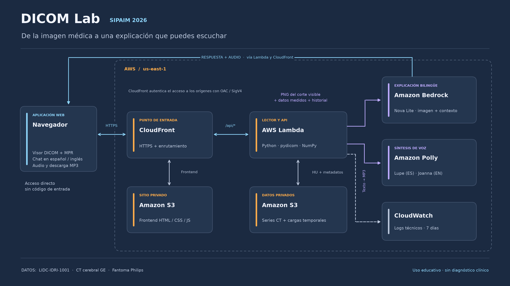

# Arquitectura del laboratorio DICOM

El esquema representa la implementación desplegada: **CloudFront + S3 + Lambda + Bedrock + Polly**, región **us-east-1**, CPU y sin autenticación adicional en la interfaz. El retorno superior del diagrama es lógico: tanto texto como audio llegan al navegador a través de Lambda y CloudFront, nunca mediante una conexión directa del navegador con Bedrock o Polly.

## Flujo de una pregunta

1. El navegador mantiene estudio, plano, corte, nivel/ancho y las últimas seis parejas de conversación.
2. CloudFront sirve HTML/CSS/JS de S3 y enruta `/api/*` a Lambda. Los dos orígenes utilizan OAC/SigV4; S3 permanece privado y la URL de Lambda exige AWS_IAM.
3. Lambda obtiene el volumen HU de S3 y genera el PNG del corte solicitado con pydicom/NumPy/Pillow. Las mediciones se calculan en HU originales, sin inferirlas del brillo.
4. Bedrock Nova Lite recibe el PNG, el contexto técnico seleccionado y el historial. Produce una explicación educativa en español o inglés. Si se pide practicar, se entrega solo una pregunta y se espera al siguiente turno del usuario.
5. La respuesta vuelve al chat. Las siguientes preguntas enviadas durante la generación quedan en una cola visible de hasta tres mensajes, y cada una recibe el historial actualizado al empezar.
6. Al solicitar audio, Polly sintetiza el texto. Si se eligió otro idioma de audio, Bedrock traduce primero. Lupe utiliza es-US y Joanna en-US, con motor neural.

## Flujo de importación

1. `/api/upload-url` devuelve una autorización S3 de 10 minutos para un ZIP de hasta 150 MB.
2. El navegador hace un POST firmado directamente al bucket privado.
3. `/api/import` lee el ZIP en memoria sin extraer rutas al disco. Descarta objetos no utilizables, selecciona la serie CT con más cortes y valida la geometría.
4. El volumen derivado conserva HU y atributos técnicos; los identificadores DICOM no se copian a los metadatos de la aplicación. Los posibles textos en píxeles siguen siendo responsabilidad del usuario.
5. Tras completar la importación se elimina el ZIP fuente. La aplicación rechaza el estudio al caducar a las 24 horas. S3 aplica una regla de expiración de un día a cargas e importaciones; la eliminación física por ciclo de vida no es inmediata al cumplirse la hora.

## Geometría

- Orden de arrays: z, y, x; espaciado en el mismo orden.
- Los cortes se ordenan por posición z para estas series axiales, no por nombre de archivo.
- Tórax: 194 cortes; PixelSpacing 0,64453125 mm; separación entre centros 1,8 mm y grosor declarado 2 mm.
- Philips: 140 cortes válidos de 1 mm; PixelSpacing 0,451171875 mm.
- GE: 28 cortes con inclinación y separaciones variables. La MPR simple se desactiva; el archivo de referencia es siempre `18.dcm`.
- Coronal y sagital invierten z y presentan la relación física entre ancho y alto. El ventaneo no cambia las intensidades originales.

## Operación y límites

Lambda usa 2048 MB, timeout de 90 segundos y concurrencia reservada de 3. El navegador permite detener una respuesta y recuperarse al superar 60 segundos; cancelar en el navegador no garantiza cancelar una inferencia que ya inició en AWS. El rol Lambda solo tiene acceso a las rutas necesarias del bucket, a Nova Lite y a síntesis Polly. Los registros técnicos caducan a los 7 días y no incluyen cuerpos de preguntas ni DICOM.

Límites de importación: ZIP de 150 MB; hasta 1000 entradas, 512 MB descomprimidos, 32 MB por instancia, matriz máxima de 1024 × 1024, 600 cortes y 64 millones de píxeles. Solo CT monocroma de una imagen por instancia y rejilla axial regular. No es un PACS ni un visor clínico multiframe.

La interfaz y la API de la demo son públicas por solicitud del propietario; los servicios internos conservan su control de acceso AWS. La concurrencia limita ejecuciones simultáneas, no impone un presupuesto monetario. El uso de la URL y de las pruebas reales consume servicios facturables.

## Actualizar y retirar

`app/deploy.py` genera el template CloudFormation, empaqueta Lambda, sube assets y datos públicos e invalida CloudFront. Cada participante selecciona su propio perfil `sipaim-lab` mediante `AWS_PROFILE` y un nombre de stack mediante `AWS_STACK_NAME`, por ejemplo `sipaim-lab-ana`. Si no define este último, el nombre es `sipaim-dicom-lab`. Lambda, logs y políticas derivan del stack; el bucket combina stack, cuenta y región. El bucket se crea como recurso de preparación fuera del stack; no se vacía ni elimina al borrar el stack.

Para retirar el proyecto, revise sus recursos en `app/deployment.json`, elimine el stack y espere su eliminación, después vacíe y elimine únicamente el bucket identificado como perteneciente a este proyecto. Conservar el notebook y el repositorio no mantiene activos Bedrock o Polly: se facturan invocaciones, no por estar documentados.

No utilice esta arquitectura como certificación de cumplimiento normativo ni como sustituto de validación clínica.
